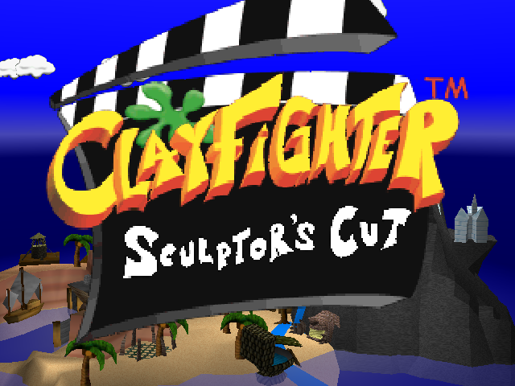
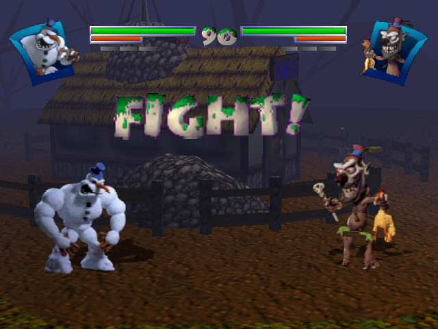
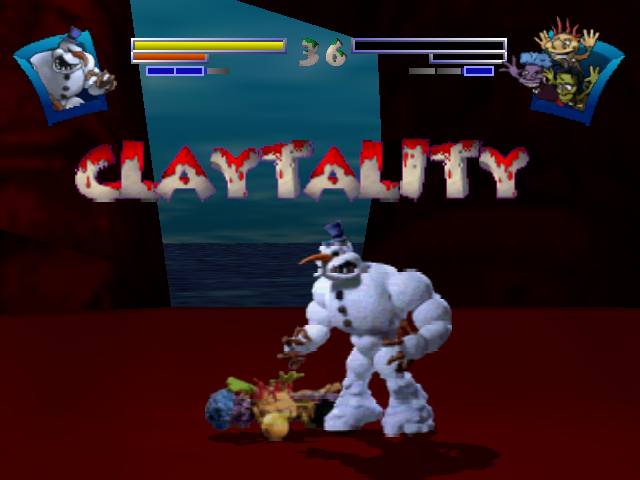

# ClayFighter: Sculptor's Cut for Sega Dreamcast

A native Sega Dreamcast port of the 1998 Nintendo 64 fighting game **ClayFighter: Sculptor's
Cut**, built on a decompilation of the N64 game.

**No game data is included.** You need your own legally owned copy of ClayFighter: Sculptor's
Cut for the Nintendo 64. The build reads the game's graphics, arenas, fighters, sound and music
from your ROM and puts them on the disc image that it makes. Please don't share any disc images
that you might build.





## AI Disclosure

This port was written with the assistance of Claude. Many hours of human testing were spent on real Dreamcast hardware, and then refining the game. If this use of AI is in conflict with your personal beliefs or values, please leave this page now. Thanks.

## Features

The N64 game's own code, decompiled to C, running natively on the Dreamcast: the same
fighters, arenas, moves, combos, Claytalities, intro, menus and music, drawn by the
Dreamcast's PowerVR graphics chip, with the game's sound played by the Dreamcast's own sound
chip.

Version 1.0 includes:

- The whole game: one player against the computer, two players against each other, every
  fighter and every arena.
- The N64's graphics turned into PowerVR polygons, with the matrix maths on the Dreamcast's
  SH-4 vector unit (SH4ZAM).
- The game's own music (its MIDI sequences) and sound effects, from samples converted from
  your ROM.
- All six attacks on the Dreamcast controller (see Controls).
- All of the game's data converted for the Dreamcast when you build: nothing is converted
  while the game runs.

Like the N64 original, the game saves nothing, so no VMU is needed.

## Requirements

- [KallistiOS](https://github.com/KallistiOS/KallistiOS) with its SH-4 toolchain
  (`kos-cc`), set up and working, and [SH4ZAM](https://github.com/gyrovorbis/sh4zam)
  (v0.10.0 or later) installed into KallistiOS.
- [mkdcdisc](https://gitlab.com/simulant/mkdcdisc), to make the `.cdi` disc image.
- A C compiler (`cc`) and Python 3 (no extra packages needed).
- Your own ClayFighter: Sculptor's Cut ROM: **ClayFighter - Sculptor's Cut (USA)**, in
  `.z64` (big-endian) byte order. The build checks it (SHA-1
  `28697fba130ded056bf7c497deaa3e154cce8022`).

## Building

1. You must own ClayFighter: Sculptor's Cut for the Nintendo 64. Make a copy of your own
   cartridge's ROM and put it in the top folder of this project, named `baserom.us.z64`.
2. Load the KallistiOS environment:

   ```
   source /opt/toolchains/dc/kos/environ.sh
   ```

3. Build:

   ```
   ./build.sh
   ```

The build checks your ROM, converts the game's data and sound from it (into `build/cd/`),
compiles the game and makes **`cfsc.cdi`**. Nothing is downloaded.

## Running

- **Real Dreamcast:** copy `cfsc.cdi` to your GDEMU (or burn it to a CD-R).
- **Emulator:** open `cfsc.cdi` in [Flycast](https://github.com/flyinghead/flycast).

## Controls

| Button | In a Fight |
|---|---|
| X | Wobbly Punch |
| Y | Fair Punch |
| Y (Hold Briefly) | Brutal Punch |
| A | Wobbly Kick |
| B | Fair Kick |
| B (Hold Briefly) | Brutal Kick |
| Left Trigger | Side-Step |
| Right Trigger | Side-Step |
| D-Pad or Analogue Stick | Move, Jump and Crouch |
| Start | Pause |

The attacks are fixed to this layout, so the game's own Button Config option is greyed out.
In the menus, the D-Pad or Stick moves and A or Start selects. Hold
**A + B + X + Y + Start** together at any time to go back to the start.

## Cheats

The N64 game's own codes for its four secret fighters, changed to suit the Dreamcast
controller: quick presses only. Hold the **Left Trigger** (not the Right Trigger) and press
the buttons in order; a sound plays when a code is entered. Then, on the character select
screen, press the **Right Trigger** on a **?** slot to step through the fighters you have
unlocked.

| Fighter | Code |
|---|---|
| Earthworm Jim | X, Y, Y, B, B, Y |
| Boogerman | X, X, B, B, Y, B |
| Sumo Santa | A, B, A, B, B, Y |
| High Five | Y, B, Y, B, X, A |

## Layout

| Folder | Contents |
|---|---|
| `src/` | The game: the decompiled N64 game's code (fighters, combat, arenas, menus, intro) and its libraries. |
| `platform/dc/` | The Dreamcast side: the N64's threads and timing, N64 graphics to PowerVR, music and sound, and KallistiOS video, sound, controllers and disc. |
| `tools/` | What the build uses: checking your ROM and converting the game's data and sound. `tools/data/` holds how the game reads each part of its data (addresses and sizes only, no game data). |
| `images/` | The screenshots on this page. |

## Credits

- [KallistiOS](https://github.com/KallistiOS/KallistiOS) and the Dreamcast homebrew
  community, [SH4ZAM](https://github.com/gyrovorbis/sh4zam),
  [mkdcdisc](https://gitlab.com/simulant/mkdcdisc), [Flycast](https://github.com/flyinghead/flycast).
- ClayFighter: Sculptor's Cut is (c) Interplay. This project is not affiliated with or
  endorsed by them.
- This is a non-commercial preservation project and is not affiliated with or endorsed by
  Nintendo or Sega.
